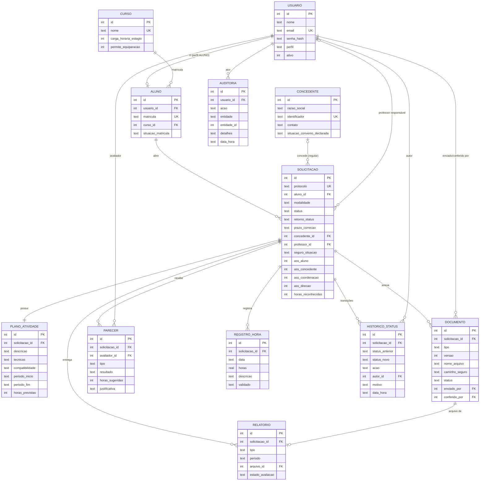

# Modelo de dados

Banco relacional SQLite com chaves estrangeiras ativadas (`PRAGMA foreign_keys = ON`). Script completo: [`backend/src/db/schema.sql`](../backend/src/db/schema.sql). Datas e horas em ISO 8601 UTC; a interface exibe no fuso America/Sao_Paulo.

## DER

## Dicionário de tabelas

| Tabela | Finalidade | Observações |
|---|---|---|
| `usuario` | Contas de acesso e perfil | `perfil` ∈ ALUNO, SECRETARIA, PROFESSOR, COORDENACAO, DIRECAO, ADMIN; senha com bcrypt |
| `aluno` | Dados acadêmicos do aluno | `situacao_matricula` REGULAR/IRREGULAR (RN-01) |
| `curso` | Cursos | `permite_equiparacao` representa a previsão no PPC (RN-12) |
| `concedente` | Empresas concedentes | Situação de convênio apenas declarada (validação humana) |
| `solicitacao` | Processo de estágio/equivalência/equiparação | `status` segue a máquina de estados; `retorno_status` indica a etapa que recebe o reenvio; `prazo_correcao` guarda a data-limite da correção (prazo expirado); campos de seguro e assinaturas só são alterados pela Secretaria/Coordenação/Direção |
| `plano_atividade` | PAE ou descrição das atividades | 1:1 com a solicitação (RN-05, RN-11) |
| `documento` | Metadados dos anexos | Arquivo em diretório privado com nome aleatório (`caminho_seguro`); nova versão marca a anterior como SUBSTITUIDO (CA-04) |
| `parecer` | Pareceres técnico, acadêmico e de avaliação final | Justificativa obrigatória (RN-13) |
| `registro_hora` | Horas executadas | Validação pelo professor responsável |
| `relatorio` | Relatórios parcial/final | Referencia o documento; estados PENDENTE, APROVADO, DEVOLVIDO, SUBSTITUIDO |
| `historico_status` | Toda transição de estado | Ator, data/hora, motivo, estado anterior e novo (RNF-06, CA-11) |
| `auditoria` | Trilha geral | Logins, uploads, downloads, conferências, pareceres, cadastros, transições recusadas — com antes/depois em JSON |

Integridade: chaves estrangeiras, `CHECK` nos domínios, `UNIQUE` em e-mail, matrícula, protocolo e identificador da concedente; alterações críticas (transições, uploads com versionamento, relatórios) em transação (`BEGIN IMMEDIATE … COMMIT`).
